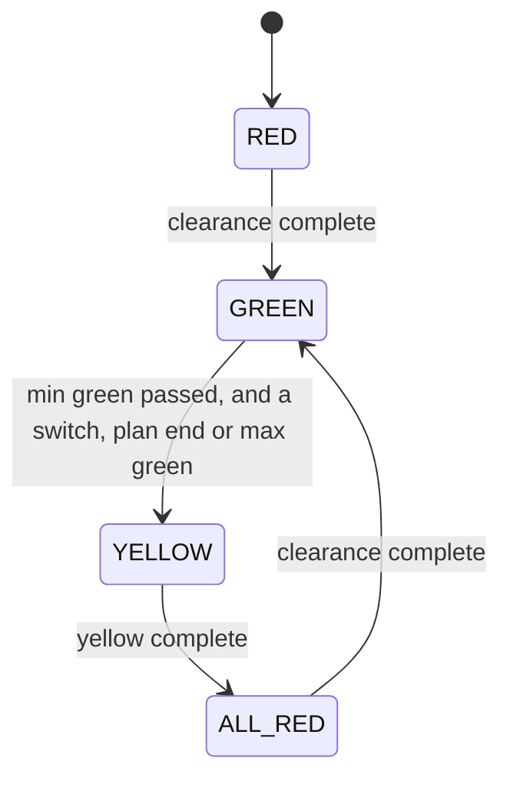
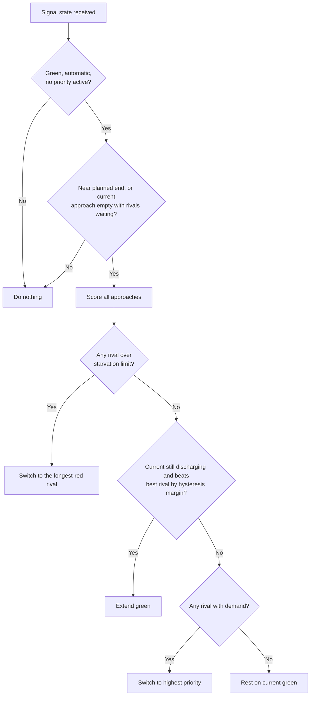
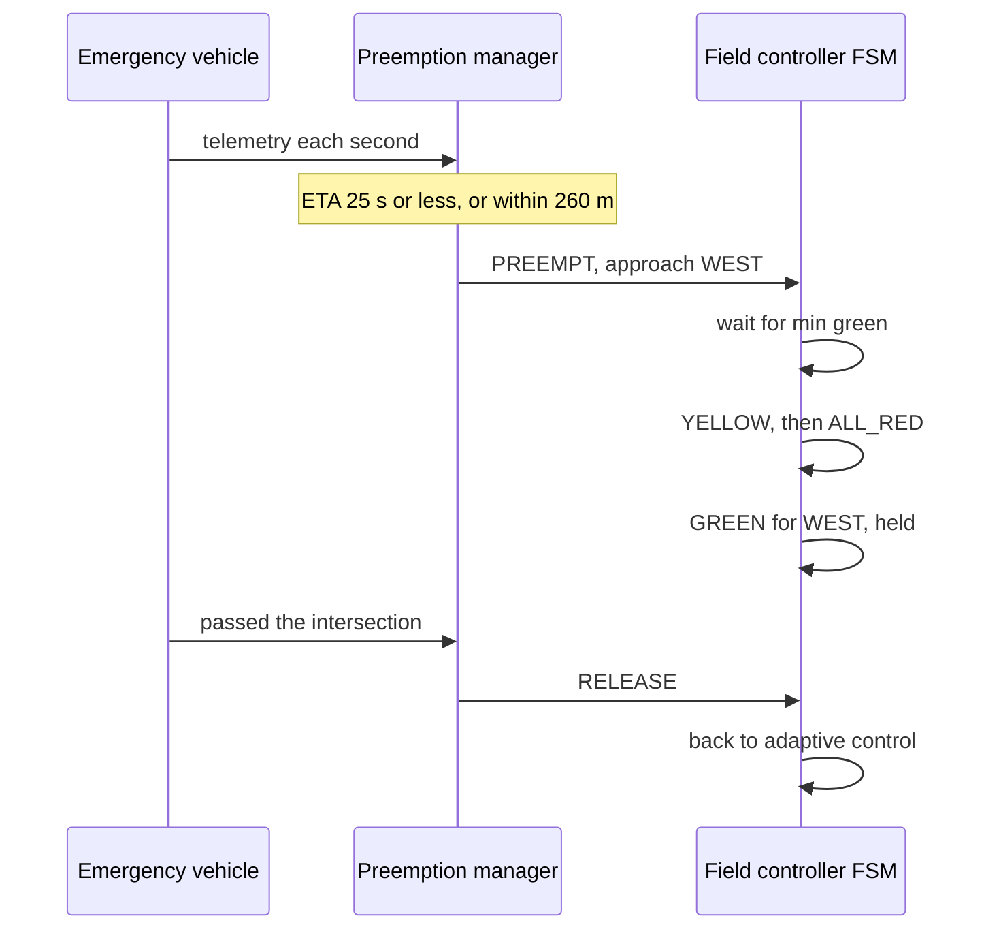

# Algorithm Explanation

## 1. Signal safety state machine

`backend/app/algorithms/signal_fsm.py`



Any other transition raises `InvalidTransition`.

| Rule | How it is enforced |
| --- | --- |
| Conflicting directions are never green together | One `active` direction, so `heads()` can only ever show one moving approach |
| Yellow always occurs | GREEN's only exit is YELLOW |
| All-red is respected | YELLOW's only exit is ALL_RED, which waits for `all_red` |
| Minimum green | Every green-ending path, preemption included, checks `elapsed >= min_green` |
| Maximum green | Extensions are capped, and the timer ends green regardless of requests |
| Invalid requests | Rejected and counted. The signal carries on |

Phasing is **split**: one approach at a time. Each approach is a single lane carrying through, left and right movements,
so opposing greens would conflict. This costs capacity, but makes the safety property simple to prove.

Two explicit cases apply to maximum green, both still bounded:

- During emergency priority, green on the vehicle's approach may be held up to `preempt_max_hold` (45 s by default) from
  when priority was served.
- In manual mode, green is held only up to maximum green. The signal then moves on, so an operator cannot starve the
  other approaches by forgetting a junction.

## 2. Adaptive signal control

`backend/app/algorithms/priority.py`, `backend/app/services/central_controller.py`

The inputs come only from sensor messages:

| Input | Normalised by |
| --- | --- |
| Queue length | ÷ 30 vehicles |
| Waiting time (longest wait in the queue) | ÷ 120 s |
| Traffic density | ÷ 100% |
| Vehicle demand (queue + approaching) | ÷ 40 vehicles |
| Low speed (only when vehicles are present) | 1 − speed ÷ free-flow speed |

All are clamped to the range 0 to 1, then combined:

```
Priority = 100 × (W1·Queue + W2·Wait + W3·Density + W4·Demand + W5·LowSpeed) / (W1+W2+W3+W4+W5)
```

Default weights are 0.35, 0.30, 0.15, 0.15 and 0.05, and can be changed on the System Settings page. An approach with no
vehicles scores zero.

### Decision cycle



**Green duration.** `2.5 s startup + (queue + half of approaching) × 2.1 s per vehicle`, clamped between minimum and
maximum green.

**Hysteresis.** The current green continues only if its score is at least 1.15 times its best rival's. Otherwise near-equal
approaches would make the signal thrash, and every switch costs 5 seconds of clearance.

**Gap-out.** If the current approach empties while another waits, the decision comes early, so green is not wasted.

**Starvation.** Once an approach with demand has been red past the limit (120 s), it is served next, longest red first.
With four approaches, none can wait more than the limit plus three maximum greens and their clearances. Red time comes from
signal state, not vehicle waits: testing showed vehicle waits under-report pressure in a crawling queue, which let one
approach go 389 s unserved under overload.

**Degraded sensors.** If detection sensors go quiet, queue is estimated from density, and waiting from time since green. If
every sensor on an approach fails, it receives a nominal demand so it is still served. The UI marks these as Estimated.

**Explanation.** Each decision is stored with its scores and a sentence of reasoning, shown in the UI.

## 3. Congestion detection

`backend/app/algorithms/congestion.py`

Four indicators each map to a level through configurable thresholds:

| Indicator | Moderate | High | Severe |
| --- | ---: | ---: | ---: |
| Queue (vehicles) | 8 | 16 | 26 |
| Occupancy (%) | 35 | 60 | 80 |
| Wait (s) | 40 | 75 | 110 |
| Speed (m/s, at or below) | 9 | 5.5 | 3 |

The result is the **second-highest** indicator, so at least two must agree. One noisy sensor cannot raise the level.

An alert opens after 45 seconds at HIGH or above, and closes after 120 seconds below it. Without this, a queue that
naturally builds in each red would flicker on and off.

## 4. Incident detection

`backend/app/algorithms/incident_detection.py`

The detector only sees sensor time series. It never sees the injected ground truth.

The first version alarmed on a drop in speed and produced about 74 false incidents per simulated half hour at rush hour,
because mid-block speed also collapses when a normal signal queue backs up. The key idea came from asking what physically
differs:

> A signal queue always sits on the stop-line detector. An obstruction leaves the queue **detached** from it: many stopped
> vehicles, but low stop-line occupancy.

| Evidence | Score |
| --- | ---: |
| Speed under 50% of its learned baseline | +0.65 |
| Speed under 60% of baseline | +0.50 |
| Detached queue: 5+ vehicles stopped, stop-line occupancy under 20% | +0.50 |
| Queue growing at 8+ vehicles per minute | +0.25 |
| Wait 1.6 times its baseline | +0.15 |
| Green given but the queue did not discharge | +0.25 |

- A sample is ignored if the queue is 9 or more vehicles and is not detached, because that is ordinary spillback.
- Low speed or a detached queue is required, and the total must reach 0.6.
- Three consecutive anomalous samples confirm a detection.
- The baseline is an exponential average that stops learning during an anomaly, so an incident cannot become the new normal.

A detection on an approach with an injected incident is matched to it. Otherwise it is recorded as **Unusual traffic**,
which is an honest false-positive category.

These thresholds were tuned against this simulation and would need recalibrating on real data.

## 5. Emergency priority

`backend/app/algorithms/preemption.py`



- Priority travels through the same FSM as any other request, so it cannot skip clearance.
- The vehicle stops at a red signal. Priority never relies on it running a red.
- Queued traffic yields, and the vehicle passes it.
- A second vehicle waits for the first to release, on a first-come basis.
- If a vehicle stalls, priority times out after the hold limit.

## 6. Traffic prediction

`backend/app/ml/`

**Task.** Predict the next 5-minute bin for each intersection: volume, waiting time and density. Congestion level is
derived from the predicted density and wait.

**Features.** Time of day as sine and cosine, weekday, weekend flag, intersection, current values, lagged values at 5, 10,
15, 30 and 60 minutes, and the hourly mean volume.

**Models.**

- Persistence: next bin equals this bin. The baseline.
- Linear regression.
- Random forest: 60 trees, depth 12.

**Evaluation.** A chronological split, with the latest 20% held out. A random split would leak future values into training
through the lag features. MAE, RMSE and R² are measured on the hold-out, and the learned model with the lowest RMSE is
selected per target.

**Live use.** Every 5 simulated minutes the selected models forecast the next bin, and each forecast is scored against what
actually happened once that time arrives.

**Honest reading of the numbers.** The training history is synthetic. It comes from a queue model with the same demand
profile as the live simulator, not from the simulator itself, so forecast error on live traffic is higher than the
hold-out suggests, especially when a scenario abruptly changes demand. Retraining after a long run includes live data.
