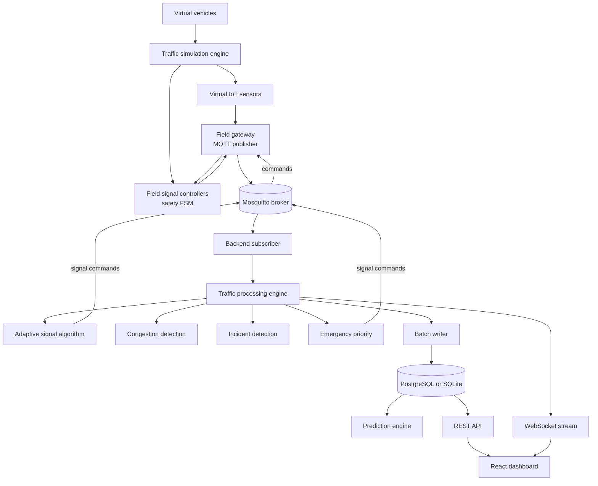
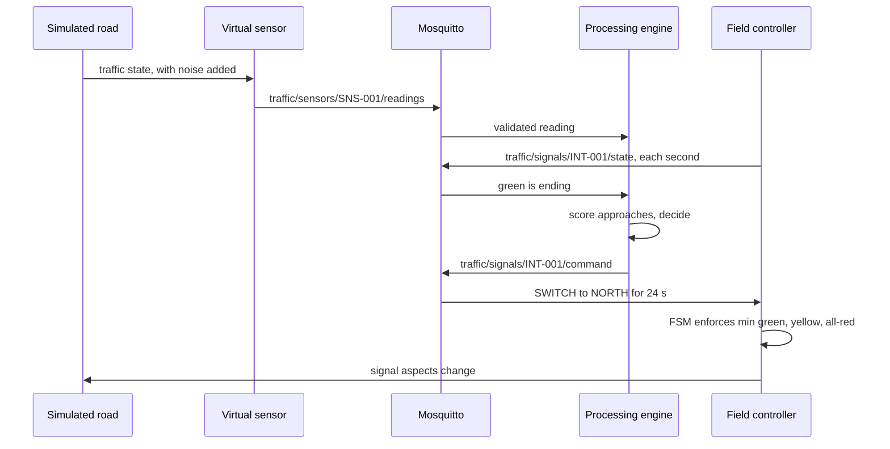
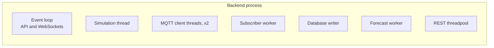

# System Architecture

All sensors and vehicles are software-simulated. No physical devices are involved.

## Overview

## The closed control loop

The important property is that the loop is closed through the broker. The adaptive algorithm has no access to the
simulator's internal state.

## Safety lives at the edge

| Concern | Location | Reason |
| --- | --- | --- |
| Signal sequence and timing limits | Field controller (`simulation/field_controller.py`, `algorithms/signal_fsm.py`) | Must hold even if the network or the central system fails |
| Choosing the direction | Central controller (`services/central_controller.py`) | Needs the sensor picture, and is allowed to be wrong or absent |

This mirrors real signal cabinets. The central system only sends requests. If commands stop arriving, the cabinet keeps
running its own safe rotation and reports `FAILSAFE`.

## Components

| Component | Module | Responsibility |
| --- | --- | --- |
| Simulation engine | `simulation/engine.py` | Vehicle movement, demand, incidents, emergency vehicles |
| Road network | `simulation/network.py` | Geometry and routes, built from database records |
| Virtual sensors | `simulation/sensors.py` | Observe the road, add noise, report at their own interval |
| Field controller | `simulation/field_controller.py` | Runs the FSM for one intersection, applies commands |
| Runner | `simulation/runner.py` | Real-time pacing on one thread, 1x to 10x |
| Field gateway | `mqtt/publisher.py` | Field-side MQTT client |
| Backend subscriber | `mqtt/subscriber.py` | Backend MQTT client and ordered work queue |
| Bus | `mqtt/bus.py` | Paho clients, reconnect logic, labelled fallback |
| Processing engine | `services/processing.py` | Validates messages, keeps live state, drives detection, alerts and rollups |
| Central controller | `services/central_controller.py` | Runs the adaptive algorithm |
| Batch writer | `services/persistence.py` | The only hot-path database writer |
| Prediction service | `ml/service.py` | Training, evaluation, live forecasts |
| WebSocket manager | `websocket/manager.py` | Fan-out, dropping old frames for slow clients |
| Runtime | `core/runtime.py` | Builds everything and owns the lifecycle |

## Concurrency

- REST handlers are plain functions, so FastAPI runs them in a threadpool and they never block the event loop.
- The simulation has its own thread. Paced ticks take under 10 ms on a laptop.
- MQTT callbacks only enqueue. One worker processes messages, which preserves their order.
- The writer drains its queue about once a second in batches. A slow database delays nothing else.
- A single runner owns a single thread and its lifecycle calls are idempotent, so repeated start requests cannot create a
  second worker. A test asserts this.

## Time

Traffic data is stamped with the **simulated city clock**, which starts at wall time, is saved regularly and never moves
backwards. Rates stay correct at 10x, a paused simulation never trips a timeout, and hour-of-day features stay meaningful.

On startup the roads are pre-filled by running the simulator silently for four simulated minutes. Nothing from that
warm-up is published or recorded, and the clock ends where it began, so it leaves no trace in stored data.

## Failure behaviour

| Failure | Behaviour |
| --- | --- |
| Broker unavailable at startup or mid-run | Switches to `LOCAL_FALLBACK`, raises an alert, reconnects by itself, resolves the alert |
| Invalid payload | Rejected by Pydantic and counted. Processing continues |
| Sensor silent | Marked offline after three intervals, alert raised, algorithm estimates that approach |
| No central commands | Cabinet runs a local rotation and reports `FAILSAFE` |
| Controller silent | Alert raised after 6 simulated seconds |
| Database failure | The batch retries row by row. Simulation continues |
| WebSocket drop | Client reconnects with backoff and gets a full snapshot |
| Backend restart | Open records closed, clock restored, history kept, models reloaded |

## Design note: in-process simulator

The simulator runs in the backend process, for a one-command start on a student laptop. It still communicates with the
processing engine only through the bus, using a separate MQTT client. The control plane (pause, scenarios, injecting
events) uses direct method calls, because that models the demo operator rather than the IoT network.
`python -m app.simulation.headless` runs the same loop with no web server, database or broker.
