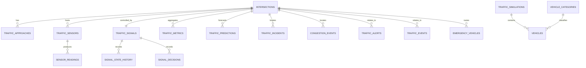

# Database Schema

SQLAlchemy models in `backend/app/models/`, migrated by Alembic (`backend/alembic/versions/`). The application applies
migrations at startup. PostgreSQL is used under Docker. SQLite is the default for local development. The same code and
migration serve both.

All timestamps are UTC. Traffic records use the simulated city clock.

## Network configuration

| Table | Purpose | Notes |
| --- | --- | --- |
| `intersections` | Junctions and their grid position | Unique on `grid_x`, `grid_y` |
| `traffic_approaches` | One row per direction: enabled flag, demand | Unique on intersection and direction, with a direction check |
| `traffic_sensors` | Virtual devices and reporting intervals | Interval check, at least 1 s |
| `traffic_signals` | One controller per intersection: mode and timing | Check that maximum green is at least minimum green |
| `vehicle_categories` | Car, motorcycle, bus, truck | Length, speed factor, share |
| `system_configuration` | Algorithm weights, thresholds, saved city clock | JSON values |

## Time series

| Table | Purpose | Notes |
| --- | --- | --- |
| `sensor_readings` | Every reading received | Nullable metric columns, because each type measures different things. Indexed on sensor and time |
| `signal_state_history` | Every completed phase with its duration and end reason | Indexed on signal and time |
| `signal_decisions` | Every adaptive decision with its reason and scores | Scores in JSON |
| `traffic_metrics` | Per-approach aggregates that feed analytics and ML | `source` is LIVE or SEEDED. Unique on time, intersection and direction |

`traffic_metrics` holds `bin_seconds` because live rows are 1-minute bins and seeded rows are 5-minute bins. Averages are
weighted by it.

## Operations

| Table | Purpose | Notes |
| --- | --- | --- |
| `traffic_simulations` | One row per simulation run | Closed on reset or shutdown |
| `vehicles` | One row per completed simulated trip | Travel time, wait, stops |
| `emergency_vehicles` | Dispatches and their outcomes | Route in JSON |
| `traffic_incidents` | Simulated incidents | `origin` is INJECTED or DETECTED, so false positives stay visible |
| `congestion_events` | Congestion history | Detection and resolution times, recommended action |
| `traffic_alerts` | Alert centre | `source` is LIVE or SEEDED |
| `traffic_events` | System event feed | |

## Machine learning

| Table | Purpose |
| --- | --- |
| `traffic_predictions` | Each forecast, with actual values filled in once they are known |
| `model_evaluations` | MAE, RMSE, R² and feature importance for each model, target and training run |

Trained models are stored as a file at `backend/data/models/traffic_models.joblib`.

## Retention

History is kept across resets and restarts. Reset closes the current run and starts a new one. Startup only closes records
left open by a previous process. Rows are deleted only by the explicit **Delete old history** action, which calls
`POST /api/system/cleanup` and requires confirmation.

## Volume

At 1x the system writes about 32 sensor rows per second, or roughly 10 MB per hour. Use the cleanup action if a demo machine
runs for days.
