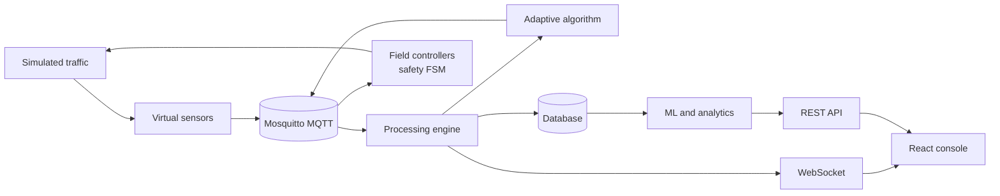

# Smart Traffic Management System

AI-assisted IoT-based intelligent traffic control and monitoring platform. Final-year project report.

> **Statement of scope.** This system uses software-simulated sensors, vehicles and signals. No physical hardware was used,
> and the system has not been deployed on any real road. All results describe behaviour inside this simulation.

## 1. Introduction

Urban intersections are usually controlled by signals that do not respond to the traffic actually present. This project
builds a complete software platform showing how an IoT-based intelligent traffic network works: virtual sensors observe
simulated traffic, publish over MQTT, and feed an adaptive controller that changes real signal state in the simulation,
with live monitoring, incident handling, emergency priority, forecasting and analytics.

## 2. Problem statement

Fixed-time signals give green to empty roads while queues wait elsewhere, and cannot react to accidents, emergency
vehicles or changing demand. A demonstration of an alternative normally needs sensors, controllers and road access, which
are not available to a student project. The problem is to demonstrate a realistic IoT traffic system, end to end, with no
hardware and no paid services.

## 3. Existing system limitations

- Fixed cycles ignore real-time demand, wasting green time and lengthening queues.
- There is no automatic response to congestion or incidents.
- Emergency vehicles wait in the same queues as everyone else.
- Each junction operates alone, with no network-wide view.
- There is little stored data for analysing or predicting traffic.

## 4. Proposed system

A monorepo with a Python simulation and backend, a local MQTT broker, a relational database and a React control console.
It provides adaptive control, congestion and incident detection, emergency priority, prediction and reporting. The
adaptive algorithm and the safety logic are deliberately separated: intelligence is central, while safety lives in a
simulated roadside controller.

## 5. Objectives

1. Monitor traffic density at multiple intersections.
2. Simulate IoT vehicle detection sensors.
3. Adjust signal timing automatically from traffic conditions.
4. Detect congestion.
5. Identify simulated accidents and unusual traffic.
6. Give priority to emergency vehicles.
7. Monitor traffic flow in real time.
8. Predict congestion from historical data.
9. Provide analytical reports and statistics.
10. Let administrators control and monitor the whole network.

## 6. System architecture

Full detail is in [architecture.md](architecture.md).

| Layer | Technology |
| --- | --- |
| Frontend | React, TypeScript, Vite, Tailwind CSS, shadcn/ui on Radix, Recharts, Framer Motion, native WebSocket |
| Backend | Python 3.11, FastAPI, Pydantic, SQLAlchemy, Alembic |
| Messaging | Eclipse Mosquitto, Paho MQTT |
| Database | PostgreSQL, with SQLite for lightweight development |
| Machine learning | scikit-learn, pandas, NumPy |
| Deployment | Docker Compose |

The live map is a locally rendered schematic drawn on an HTML canvas. It needs no tiles or map service, so React Leaflet
was not required.

## 7. Hardware-free IoT methodology

Real IoT systems have sensing, communication, processing and actuation. This project keeps all four and replaces only the
physical ends.

| IoT layer | Physical system | This project |
| --- | --- | --- |
| Sensing | Loops, radar, cameras | Virtual sensors observing a microscopic traffic simulation |
| Communication | Cellular, fibre, MQTT | Real MQTT over a real local broker |
| Processing | Traffic management centre | Real backend software |
| Actuation | Signal cabinet | Virtual field controller with a real safety state machine |

So the protocols, payload validation, failure handling and decision logic are genuine, and the substitution is limited to
where the data originates and where the signal is displayed.

## 8. MQTT communication

Details are in [mqtt-topics.md](mqtt-topics.md). Two separate MQTT clients act as field gateway and backend, so all sensor
data crosses the broker, and commands return the same way. Every payload is schema-validated. Paho reconnects
automatically, and a clearly labelled in-process fallback keeps the demonstration running when the broker is unavailable.

This behaviour was verified with an independent `mosquitto_sub` client, and by stopping the broker during a run: the mode
changed to `LOCAL_FALLBACK`, an alert was raised, traffic continued, and the system reconnected and resolved the alert
when the broker returned.

## 9. Sensor simulation methodology

There are 126 virtual sensors: five types on each of 24 approaches, plus one environmental sensor per intersection.

Readings are not random numbers. Each sensor observes the simulated road and adds small measurement noise:

| Sensor | Measures |
| --- | --- |
| Vehicle detection | Stopped vehicles, approaching vehicles, wait times |
| Traffic density | Vehicles on the road against its jam capacity |
| Vehicle counting | Stop-line crossings, with a 2% miss rate |
| Road occupancy | Share of a 40 m stop-line zone covered, averaged over the interval |
| Average speed | Mean speed in a mid-block zone, upstream of the usual queue |
| Environmental | Temperature, rainfall and visibility |

Vehicles follow a safe-speed car-following model, so congestion, spillback and incident effects emerge from the
simulation. Demand follows a time-of-day profile, or a scenario's demand. Sensors can fail temporarily, in which case
they go silent, and the backend must notice this by itself.

Seeded history comes from a separate queue model with the same demand profile, because running the microscopic simulation
for 14 simulated days would take hours. Those rows are labelled `SEEDED` and live rows `LIVE`.

## 10. Traffic optimization algorithm

Full detail is in [algorithm-explanation.md](algorithm-explanation.md).

Each approach gets a priority score from normalised queue, waiting time, density, demand and low speed. Near the end of
each green the controller extends, switches to the highest-priority approach, or serves a starving approach. Green length
follows the queue, within minimum and maximum limits. Each decision is recorded with its reasoning.

A separate finite-state machine (RED, GREEN, YELLOW, ALL_RED) enforces safety and treats every input as a request.

## 11. Machine learning methodology

Next-5-minute volume, wait and density are predicted for each intersection from time features and lagged values. A
persistence baseline is compared against linear regression and a random forest, using a chronological 80/20 split. Results
are in section 14.

## 12. Database schema

There are 19 tables covering network configuration, time series, operations and machine learning. See
[database-schema.md](database-schema.md). Migrations are managed by Alembic, and the same migration runs on PostgreSQL and
SQLite.

## 13. API documentation

Interactive Swagger documentation is at <http://localhost:8000/docs>.

| Area | Endpoints |
| --- | --- |
| Dashboard | `GET /api/dashboard/overview`, `/live`, `/series`, `/topology`, `/events` |
| Intersections | `GET, POST /api/intersections`; `GET, PATCH /api/intersections/{id}`; `GET .../traffic`, `/history`, `/health`; `PATCH .../approaches/{direction}` |
| Sensors | `GET, POST /api/sensors`; `GET, PATCH /api/sensors/{id}`; `GET .../readings`; `POST .../restart` |
| Signals | `GET /api/signals`, `/{id}`; `POST .../mode`, `/manual-control`; `PUT .../timing`; `GET .../decisions`, `/history` |
| Simulation | `GET /api/simulation/status`, `/scenarios`, `/vehicle-categories`; `POST .../start`, `/pause`, `/resume`, `/reset`, `/speed`, `/parameters`, `/scenario`, `/weather`, `/sensor-failure`, `/controller-failure` |
| Emergency | `GET, POST /api/emergency-vehicles`; `GET .../route`; `DELETE .../{id}` |
| Incidents | `GET /api/incidents`; `POST /api/incidents/simulate`; `POST .../{id}/resolve`; `GET /api/congestion` |
| Alerts | `GET /api/alerts`; `POST /api/alerts/{id}/acknowledge`; `POST /api/alerts/acknowledge-all` |
| Analytics | `GET /api/analytics/traffic`, `/export` |
| Predictions | `GET /api/predictions`, `/evaluation`, `/backtest`; `POST /api/predictions/train` |
| System | `GET /api/system/health`; `GET, PUT /api/system/config`; `POST /api/system/cleanup` |
| Real time | `WS /ws/live` |

Errors share one shape: `{"error": {"code", "message", "details"}}`.

## 14. Testing results

### Automated tests

| Suite | Tool | Result |
| --- | --- | --- |
| Backend unit, closed-loop and API | pytest | 185 passed |
| Frontend component and integration | Vitest | 26 passed |
| End-to-end workflows in a real browser | Playwright | 8 passed, three consecutive runs against the production Docker build |

The most important test is a randomised fuzz test. It sends hostile requests to the signal state machine across 25 seeds
and 12,000 ticks each, and checks on every tick that no two directions are ever moving at once, and that minimum green,
maximum green, yellow and all-red hold. A separate test asserts no conflicting aspects in the full simulation, in every
scenario.

### System verification

| Check | Result |
| --- | --- |
| Clean install from empty volumes | Ready in 18 s with 96,768 seeded rows and traffic already on the roads, models trained 12 s later |
| Independent MQTT subscriber | Saw live sensor readings and adaptive commands |
| Broker stopped mid-run | Labelled fallback, alert raised, traffic continued |
| Broker restarted | Reconnected by itself, alert resolved |
| Full `docker compose down` and `up` | All history kept, no stale alerts, models reloaded, clock moved forward |

### Adaptive against fixed-time control

Measured with `python -m app.simulation.benchmark --seeds 5 --minutes 30`, using identical demand per seed after a
five-minute warm-up.

| Scenario | Control | Trips | Mean travel (s) | Mean wait (s) | Wait range across seeds (s) |
| --- | --- | ---: | ---: | ---: | --- |
| Normal | Adaptive | 1108 | 128.6 | 40.2 | 39.4 to 42.0 |
| Normal | Fixed time | 1096 | 186.1 | 96.8 | 95.6 to 98.1 |
| Morning rush | Adaptive | 1874 | 226.2 | 127.5 | 121.9 to 135.6 |
| Morning rush | Fixed time | 1647 | 312.0 | 210.3 | 201.3 to 214.1 |
| Heavy congestion | Adaptive | 1973 | 380.2 | 269.9 | 241.7 to 308.1 |
| Heavy congestion | Fixed time | 1902 | 410.2 | 299.8 | 284.0 to 322.7 |

Mean wait fell by about 59% in normal traffic, 39% at rush hour and 10% in overload.

How to read this fairly:

- The baseline is a simple rotation with 20 s of green for every approach. It is **not** an optimised fixed-time plan, so
  these figures overstate the gain against a well-tuned real system.
- The benefit shrinks as demand exceeds capacity, as expected, because no signal plan can create capacity. In overload the
  seed ranges overlap, so that 10% is a weak result.
- The Normal scenario follows the time-of-day profile, so its absolute numbers depend on when the benchmark is run.
- The results come from five seeds on one network.

### Incident detection

25 incidents were injected in steady traffic. The detector only saw sensor data.

| Incident type | Detected | Mean time to detect (s) |
| --- | ---: | ---: |
| Major accident | 5 of 5 | 33 |
| Road blockage | 5 of 5 | 33 |
| Minor accident | 5 of 5 | 76 |
| Sudden slowdown | 5 of 5 | 40 |
| Lane closure | 4 of 5 | 31 |

False incidents with nothing injected, over one simulated hour across five seeds:

| Scenario | False incidents per simulated hour |
| --- | ---: |
| Normal | 0.0 |
| Morning rush | 0.8 |
| Heavy congestion | 0.2 |

One lane closure was missed. Thresholds were tuned on this simulation, so these rates are optimistic. Detection also
depends on traffic being present: an incident on an almost empty road gives the sensors little to see.

### Emergency priority

An ambulance crossing from INT-001 to INT-006 during the morning rush, across five seeds:

| Case | Mean travel time (s) | Arrived |
| --- | ---: | ---: |
| With signal priority | 111.6 | 5 of 5 |
| Without signal priority | 225.7 | 5 of 5 |

### Prediction

Held-out test on the most recent 20% of history: 19,290 training rows and 4,824 test rows. These figures are from one
clean install. Seeded history is anchored to the time of installation, so values shift slightly between installs, and
the Traffic Prediction page always shows the figures for the models actually loaded. Across two installs the same models
were selected. RMSE moved by up to 0.3, except the random forest on waiting time, which moved from 4.49 to 5.63. That
instability is another reason not to read much into small differences between these models.

| Target | Model | MAE | RMSE | R² |
| --- | --- | ---: | ---: | ---: |
| Volume (vehicles per 5 min) | Persistence | 7.24 | 9.70 | 0.935 |
| | Linear regression | 6.15 | 8.28 | 0.953 |
| | **Random forest (selected)** | 5.91 | 8.05 | 0.956 |
| Waiting time (s) | Persistence | 2.88 | 4.91 | 0.978 |
| | **Linear regression (selected)** | 2.65 | 4.26 | 0.983 |
| | Random forest | 2.66 | 5.63 | 0.970 |
| Density (%) | Persistence | 2.71 | 3.78 | 0.960 |
| | **Linear regression (selected)** | 2.35 | 3.33 | 0.969 |
| | Random forest | 2.34 | 3.35 | 0.968 |

The selected models improve RMSE over persistence by about 12% to 17%. The high R² values are mostly a property of the data:
traffic in five minutes closely resembles traffic now, and the history is synthetic, so these figures must not be read as
real-world accuracy. The random forest gives little over linear regression here. Forecasts of live traffic are visibly
worse than these figures, particularly right after a scenario changes demand, because models are trained on seeded
history from a different generator.

## 15. Limitations

- All data is simulated. Nothing here has been validated against real traffic.
- The benchmark baseline is an unoptimised fixed-time rotation.
- Each junction is optimised independently, with no green-wave coordination between neighbours.
- Each approach is one lane with split phasing, and there are no pedestrians or dedicated turn phases.
- Vehicles follow simple rules and do not re-route around congestion.
- Detection and algorithm thresholds were tuned on this simulation.
- The simulator shares a process with the backend, though it communicates only through the bus.
- MQTT uses no authentication or TLS and is bound to the local machine. A real deployment needs both.
- The console has no user authentication, for the same reason.
- Seeded history comes from a simpler model than the live simulator.
- Adding an intersection or disabling an approach rebuilds the network and resets the running simulation.

## 16. Future scope

- Connect real sensors, or an ESP32 test rig, using the same MQTT topics and payloads.
- Calibrate demand and thresholds with real traffic counts.
- Coordinate neighbouring signals, or evaluate reinforcement-learning control against this baseline.
- Add multi-lane roads, turn phases, pedestrians and public transport priority.
- Compare against an optimised fixed-time plan, for example using Webster's method.
- Add TLS, authentication and role-based access.
- Run the simulator as a separate service.

## 17. Installation instructions

See [README.md](../README.md) for exact PowerShell commands and [demo-guide.md](demo-guide.md) for the evaluation
walkthrough.
